# slack-emojis

Custom Slack emojis I've created (generated with ChatGPT, cleaned up and resized). Private archive so I never have to rebuild them.

## Contents

- `emojis/` — 62 finished PNGs. The filename is the Slack emoji name.

## Adding a new emoji

1. Drop the final PNG into `emojis/` using a lowercase-hyphenated name.
2. Add it to the table below.
3. Commit and push.

## Catalog

| Preview | Name |
|---|---|
|  | `:insane-laugh-angry-red:` |
|  | `:insane-laugh-army-helmet:` |
| 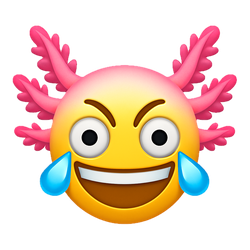 | `:insane-laugh-axolotl:` |
| 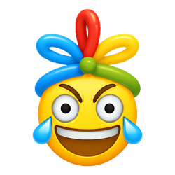 | `:insane-laugh-balloon-hat:` |
|  | `:insane-laugh-bandit:` |
| 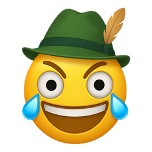 | `:insane-laugh-bavaria:` |
| 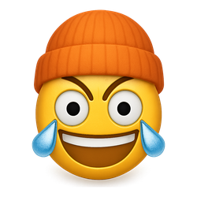 | `:insane-laugh-beanie:` |
|  | `:insane-laugh-beard:` |
| 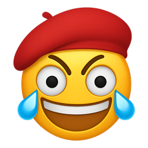 | `:insane-laugh-beret:` |
|  | `:insane-laugh-blood:` |
|  | `:insane-laugh-blush-heart:` |
|  | `:insane-laugh-bobby:` |
| 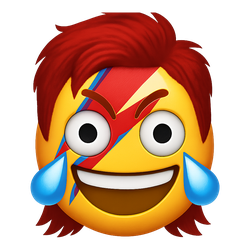 | `:insane-laugh-bowie:` |
| 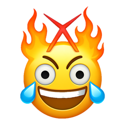 | `:insane-laugh-burning-man:` |
|  | `:insane-laugh-captain:` |
|  | `:insane-laugh-chef:` |
|  | `:insane-laugh-dog:` |
| 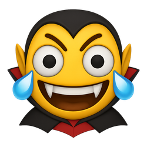 | `:insane-laugh-dracula:` |
| 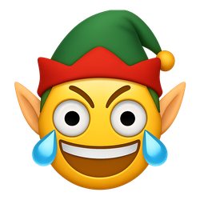 | `:insane-laugh-elf:` |
| 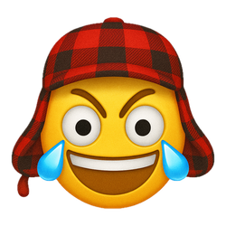 | `:insane-laugh-elmer-fudd:` |
| 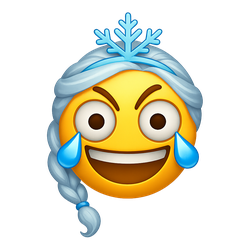 | `:insane-laugh-elsa:` |
|  | `:insane-laugh-emo:` |
|  | `:insane-laugh-fedora:` |
| 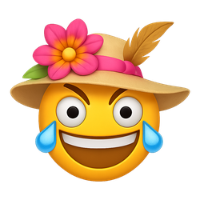 | `:insane-laugh-flower-hat:` |
| 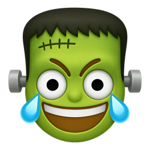 | `:insane-laugh-frankenstein:` |
|  | `:insane-laugh-freddie-mercury:` |
|  | `:insane-laugh-ghost:` |
|  | `:insane-laugh-halo-2:` |
|  | `:insane-laugh-halo:` |
|  | `:insane-laugh-hard-hat:` |
|  | `:insane-laugh-indiana-jones:` |
|  | `:insane-laugh-jack-o-lantern:` |
|  | `:insane-laugh-lady-liberty:` |
| 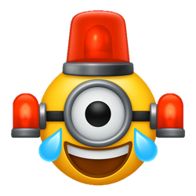 | `:insane-laugh-minion:` |
|  | `:insane-laugh-monocle:` |
|  | `:insane-laugh-mouse:` |
|  | `:insane-laugh-old-man:` |
|  | `:insane-laugh-party-blower:` |
|  | `:insane-laugh-party-hat:` |
|  | `:insane-laugh-pilgrim:` |
| 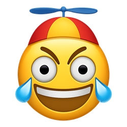 | `:insane-laugh-propeller-cap:` |
|  | `:insane-laugh-rainbow-heart-2:` |
|  | `:insane-laugh-rainbow-heart:` |
|  | `:insane-laugh-rainbow:` |
| 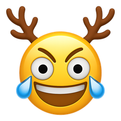 | `:insane-laugh-reindeer:` |
| 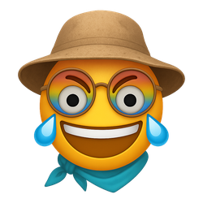 | `:insane-laugh-safari-hat:` |
|  | `:insane-laugh-santa-hat:` |
|  | `:insane-laugh-santa:` |
|  | `:insane-laugh-scottish:` |
| 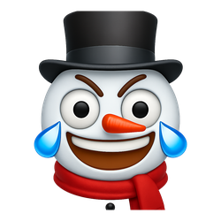 | `:insane-laugh-snowman:` |
| 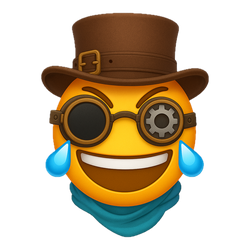 | `:insane-laugh-steampunk:` |
|  | `:insane-laugh-tiara:` |
|  | `:insane-laugh-tinfoil-hat:` |
|  | `:insane-laugh-turkey-hat:` |
|  | `:insane-laugh-ushanka:` |
| 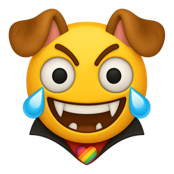 | `:insane-laugh-vampire-dog:` |
| 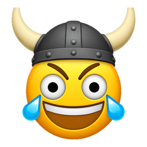 | `:insane-laugh-viking:` |
| 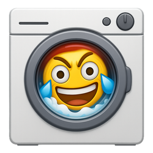 | `:insane-laugh-washing-machine:` |
| 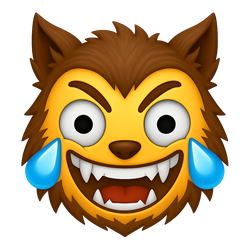 | `:insane-laugh-werewolf:` |
|  | `:insane-laugh-wizard-hat-2:` |
| 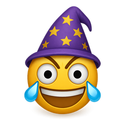 | `:insane-laugh-wizard-hat:` |
|  | `:insane-laugh-yoda:` |
